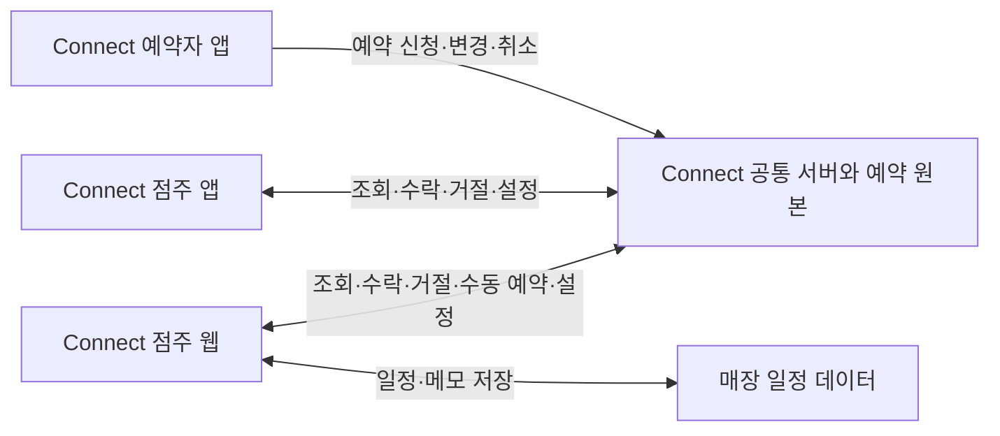

# Connect 점주 웹 예약 및 일정 관리 PRD

- 버전: 0.2
- 작성·조사 기준일: 2026-10-13
- 상태: 제작 전 범위·디자인 검토안
- 대상: 기획·디자인·개발 담당자
- 최신 기준 문서: 이 Markdown 파일. 기존 `점주용_예약일정관리_PRD_v0.1.docx`는 이전 방향을 기록한 문서다.

## 1. 제품 방향

**Connect 앱에서 발생한 예약을 자동으로 확인하고, 앱의 점주 기능과 매장 일정 관리를 웹에서 수행한다.** 기존 Connect 점주 계정과 매장·예약 데이터를 공유하는 점주용 웹을 만든다.

전화·문자·현장 예약은 앱에서 지원하는 수동 예약으로 같은 장부에 등록한다. 앱 예약을 웹에 다시 입력하거나 별도 복제 장부를 유지하지 않는다. 웹에서 수락·거절·시간 차단·예약 설정을 변경하면 앱도 같은 서버 결과를 보여줘야 한다.

### 이번에 확정된 범위

1. Connect 앱 예약 자동 연계를 MVP에 포함한다.
2. 앱에서 점주로 로그인했을 때 실제로 사용할 수 있는 기능을 웹 MVP의 기준으로 삼는다.
3. 예약과 함께 매장 일정을 관리할 수 있게 한다.
4. 제작에 앞서 디자인 시스템을 검토·선택한다. 본 문서의 디자인 토큰은 제안이며 아직 확정되지 않았다.

### 이전 PRD에서 변경한 사항

| 항목 | v0.1 | v0.2 현재 기준 |
|---|---|---|
| 제품 관계 | 독립적인 수기 장부 대체 도구 | Connect 점주 기능의 웹 확장 |
| 앱 연계 | 초기 범위에 명확히 포함되지 않음 | 앱 예약 자동 조회와 공통 상태 반영이 P0 |
| 로그인 | 독립 계정·직원 초대 제안 | 기존 Connect 점주 계정과 매장 소유권 사용 |
| 예약 규칙 | 테이블별 시간 겹침·예외 저장 제안 | Connect의 정원·공유 예약·시간 차단 정책 준수 |
| 예약 상태 | 예약·방문중·완료·취소·노쇼 제안 | 기존 Connect 상태를 우선 사용. 새 상태를 웹만 추가하지 않음 |
| 심야 처리 | 별도 영업일 경계 설정 제안 | 기존 `service_date`와 24시 이상 시간 표현 사용 |
| 브랜드 | 하루장부 작업명·녹색 시제품 | Connect 브랜드와 라임 토큰 계승 제안 |
| 추가 기능 | 직원 공유·세부 테이블 관리까지 초기 제안 | 별도 직원 권한·테이블 배치는 후속 검토 |

## 2. 문제와 근거

사용자 설명에 따르면 인터뷰한 점주들은 화이트보드나 공책에 예약·일정을 수기로 정리한다. 앱 예약과 오프라인 기록을 따로 관리하게 되면 같은 내용을 옮겨 적어야 할 수 있으므로, Connect 예약이 자동으로 나타나는 공통 관리 화면을 제공한다.

| 근거 수준 | 내용 |
|---|---|
| 사용자 확인 | 인터뷰 점주가 화이트보드·공책을 사용함. 점주용 관리 우선. 앱 연계와 일정 관리를 MVP로 선택함 |
| 저장소 확인 | Expo 앱 `ConnectRN`에 점주 대시보드, 캘린더, 수동 예약, 시간 차단, 매장 설정 화면과 서버 호출 코드가 있음 |
| 추가 확인 필요 | 인터뷰 수·업종 구성·예약량·전환 의향·현재 기기·누락 빈도 |
| 자료의 제한 | `Connect_점주인터뷰.pptx`는 서비스 제안과 질문지이며 실제 인터뷰 응답 기록이 아님 |

목표 과업은 신규 앱 요청 확인, 수락·거절, 오늘 예약 조회, 전화 예약 등록, 예약받지 않을 시간 차단, 매장 일정 확인이다. 점주 연령·IT 숙련도·매출 손실 규모는 임의로 확정하지 않는다.

## 3. 기존 제품 조사

공식 소개·공지·사업자 앱 설명을 기준으로 정리했다. 유료 관리자 계정으로 사용성을 직접 테스트한 결과는 아니다. 공개 자료에서 확인되지 않는 기능은 미지원이라고 단정하지 않는다.

| 제품 | 확인한 기능 | 이번 제품에 주는 시사점 | 비용·확인 제한 |
|---|---|---|---|
| [캐치테이블](https://biz.catchtable.co.kr/n/knowhow/reservation-guide) | 전화·네이버 등 예약 통합, 예약금·0원 결제 안내 | 예약 통합 자체보다 Connect 앱과 동일한 업무 흐름·빠른 처리가 중요 | 기본 정액 요금은 이번 자료에서 확정하지 않음 |
| [네이버 예약 스마트플레이스](https://smartplace.naver.com/notices/1098) | 식당형 예약 간격·점유시간·예약금·메뉴·환불 기준 | 예약 시간과 점유 시간, 대기와 확정을 명확히 구분해야 함 | 2026-09-01 공지에서 대시보드·고객·테이블 관리는 제공 예정으로 안내. 최신 상태 재확인 필요 |
| [테이블매니저 KT AI 통화비서 연계](https://www.tablemanager.io/cashnote) | 전화·네이버·카카오 예약 통합과 AI 응대 | 전화 수동 등록과 앱 예약을 함께 보는 수요 참고 | 해당 연계 상품 스탠다드 월 22,000원, 라이트 월 5,500원 VAT 포함 표기. 라이트는 예약·주문 미제공. 전체 제품 요금으로 일반화하지 않음 |
| [테이블링 사장님보드](https://play.google.com/store/apps/details?hl=ko&id=com.tabling.ceoboard) | 대기·예약·주문·고객·매장 관리, 테이블별 예약 및 방문 이력 | 점주가 반복하는 업무를 명확한 메뉴로 나누는 구성 참고 | 기기·계약·총비용은 추가 확인 필요 |
| [나우웨이팅](https://www.nowwaiting.co.kr/services/waiting) | 대기 등록·알림톡 안내·직원 입장 처리·재방문 고객 확인 | 긴 설명보다 현장 행동 중심으로 단순하게 설계 | 사전 예약 장부 전체 기능과 월 총요금은 추가 확인 필요 |

### 차별화 가설

기존 서비스에도 예약 통합 관리가 있다. Connect 웹의 직접적인 가치는 **Connect에서 들어온 요청을 다시 입력하지 않고 기존 앱과 동일하게 처리하면서 매장 일정까지 함께 확인하는 것**이다. 넓은 화면, 최소 입력, 명확한 저장·연결 상태가 일상 운영을 개선하는지 검증한다.

현재 수기 장부와 범용 캘린더도 비교 대상이다. 예약 없는 날 사용률보다 예약 발생일에 실제로 장부로 선택하는지를 살핀다. 별도 유료 판매 여부·가격·다지점 전략은 이번 MVP에서 결정하지 않는다.

## 4. 현재 앱 기능 확인과 MVP 대응

소스 코드를 읽어 확인한 상태다. 앱·웹·실서버 간 종단간 검증을 완료했다는 의미는 아니다. 오래된 `SPEC.md`의 완료 표시보다 현재 `ConnectRN` 코드와 서버 정책 문서를 우선 참고한다.

| 앱 영역 | 현재 코드에서 확인한 내용 | 웹 MVP 대응 |
|---|---|---|
| 점주 로그인 | 기존 Connect 인증·계정 상태 사용 | 동일 점주 계정 로그인, 소유 매장 확인, 세션 종료 |
| 대시보드 | `pending` 요청 목록, 수락·거절, 7일 이내 확정 예약 | 신규 요청을 우선 노출하고 같은 예약 ID로 처리 |
| 예약 캘린더 | 월간 달력, 선택 날짜 예약, 시간표·수동 예약 진입 | 월간·일간 화면과 예약 목록 제공 |
| 수동 예약 | 예약자/단체명, 날짜, 인원, 연속 시간 슬롯, 메모 | 전화·현장 예약 등록. 앱과 동일한 입력 규칙·서버 저장 사용 |
| 시간 차단 | 가용성 조회, 30분 단위 차단·해제 | 예약 가능·차단·정원 마감 구분과 앱 반영 |
| 매장 설정 | 정원, 영업 시작·종료, 공유 예약 허용 변경 | 같은 서버 검증과 설정값 사용 |
| 마이페이지 | 매장 정보, 글씨 크기, 로그아웃 | 매장 설정과 화면 글씨 크기 제공 |
| 채팅 | 목록·대화 UI가 있으나 전송 함수는 ‘채팅 준비 중’ 안내 | 현재 동작 기능으로 간주하지 않음. 실제 메시징 연동은 후속 범위 |
| 기타 메뉴 | 결제 수단·약관·FAQ 메뉴 중 동작 없는 항목 존재 | 실제 기능이 준비되기 전 작동하는 메뉴처럼 노출하지 않음 |
| 사진·상세 소개·지도 | 현재 설정 화면에 준비 중 안내 | 초기 필수 편집 범위에서 제외 |

`StoreInfoEditScreen`의 ‘가게정보 관리’는 현재 정원·영업시간·공유 예약 설정 중심이다. 이름·사진·소개 전체 편집을 이미 완성된 기능으로 해석하지 않는다.

## 5. MVP 범위

### P0 제작 범위

- Connect 점주 로그인과 소유 매장 접근 제어.
- 앱에서 접수된 예약의 자동 조회·갱신.
- 신규 요청의 수락·거절과 처리 결과의 앱 반영.
- 일간·월간 예약 조회, 상태·유입 구분, 날짜 이동.
- 앱과 동일한 수동 예약 등록.
- 30분 단위 시간 차단·해제, 잔여 정원 조회.
- 매장 정원·영업시간·공유 예약 설정.
- 매장 일정 등록·조회·수정·삭제와 날짜별 메모.
- 저장 중·완료·실패, 연결 끊김·재연결 상태 표시.
- 글씨 크기 조절, PC·태블릿·모바일 대응.

### 후속 범위

- 채팅 실서버 연동, 직원 초대와 직원별 권한.
- 상세 테이블 배치·복수 테이블 할당·좌석 자동 배정.
- 주간 달력, 반복 일정, 예약·일정 내보내기.
- 알림톡·문자·브라우저 푸시, 고객 이력 분석.
- 앱·웹 공통으로 지원할 방문중·노쇼 등 추가 상태.
- 앱과 웹에서 점주가 예약을 수정·취소·완료하는 추가 UI는 실제 공통 API·권한·화면 지원 확인 후 별도로 범위를 확정한다. 서버에 함수가 있다는 이유만으로 현재 점주 화면 기능이라고 보지 않는다.

### 이번 범위 밖

신규 고객용 웹 예약 접수, 결제·환불, 대학 인증 재설계, 예약 양도, POS 및 타 플랫폼 자동 연동, AI 통화·OCR, 매출 리포트, 다지점 통합. 고객은 기존 Connect 앱에서 예약하며 그 요청을 점주 웹에서 처리한다.

## 6. 앱과 웹 연계 원칙

- 앱과 웹은 같은 사용자·매장·예약 식별자를 사용한다. 웹 전용 예약 복사본을 원본으로 운영하지 않는다.
- **자동 표시와 자동 수락은 다르다.** 앱에서 들어온 `pending` 요청은 웹에도 대기 상태로 표시하고 점주 판단을 기다린다.
- 최초 진입·재접속·탭 복귀 시 서버를 다시 조회한다. 서버 변경 알림 또는 주기적 조회를 통해 열린 웹 화면도 갱신한다.
- 구체적인 갱신 방식은 구현 전 현재 서버 구성과 권한을 확인해 선택한다. 정상 연결 시 5초 이내 표시를 초기 목표로 삼는다.
- 웹에서 수락한 예약은 앱에서 확정 상태로 보인다. 앱에서 변경·취소된 예약은 웹의 목록·달력·인원 집계에도 반영한다.
- 변경 알림을 중복 수신해도 예약 ID를 기준으로 갱신하며 새 예약을 추가 생성하지 않는다.
- 저장 성공은 서버 응답으로 판단한다. 오류·오프라인 상태에서 저장 완료나 예약 수락 완료로 표시하지 않는다.
- 현재 앱은 Supabase 기반 호출 코드를 사용한다. 웹도 기존 인증·권한·RPC 계약의 재사용을 우선 검토하며, 배포된 스키마와 실제 연결 상태는 구현 전 확인한다.
- 별도 직원 계정은 초기 요구사항이 아니다. MVP의 같은 계정 여러 기기 사용과 이후 직원별 권한은 구분한다.

## 7. 예약과 일정 정책

### 7.1 기존 예약 정책 유지

정책 근거는 `docs/SUPABASE_MIGRATION_PLAN.md`의 ‘1차 예약 정책’과 앱 시간 변환 코드다. 실제 구현 시 서버 코드·배포 상태와 대조한다.

| 항목 | MVP 규칙 |
|---|---|
| 시간 단위 | 연속된 30분 슬롯 1~6개. 웹만 별도 최대 이용시간을 만들지 않음 |
| 영업일 | Asia/Seoul 기준 `service_date`와 시작 분 사용 |
| 심야 | 다음 날 00:30을 해당 영업일의 24:30으로 표현. 화면에 ‘다음 날 00:30’ 보조 표기 |
| 대기 요청 | `pending`은 좌석을 점유하지 않음 |
| 확정·수동 예약 | 서버 정책에 따라 좌석 점유 |
| 공유 예약 허용 | 겹치는 각 슬롯의 확정 인원 합계가 정원 이하 |
| 공유 예약 미허용 | 같은 시간대에 확정 예약 하나만 허용 |
| 수락 | 대기 요청만 가능. 수락 시 가용성을 서버에서 다시 검사 |
| 예약자 수정 | 기존 정책에 따라 `pending`으로 돌아가 재승인 필요. 기존 점유 해제 안내 |
| 시간 차단 | 기존 확정 예약과 겹치면 서버가 거부. 대기 요청은 수락 시 다시 검사 |
| 설정 변경 | 기존 확정 예약을 무효화하지 않는 범위에서 변경 |

정원 초과·차단 시간을 웹에서 ‘경고 무시 후 저장’으로 우회하지 않는다. 동일한 시간에 예약이 있다는 사실만으로 중복이라고 판단하지 않고 공유 예약 설정과 잔여 정원을 함께 확인한다.

### 7.2 상태 표현

웹의 요청 수락·거절에는 기존 `pending`, `confirmed`, `rejected` 상태를 사용한다. 취소·완료 등 서버의 기존 상태는 앱과 같은 의미로 표시한다. 실제 허용되는 변경은 기존 정책에 한정한다.

‘신규 요청’과 ‘오늘 확정 예약’을 별도로 집계한다. 대기 인원을 확정 방문 인원에 더하지 않는다. 출처는 `Connect 앱`과 `직접 등록` 배지로 구분하고, 예약 상태와 출처를 같은 색상 체계로 섞지 않는다.

### 7.3 일정 관리 추가

| 유형 | 예시 | 예약 가용성에 미치는 영향 |
|---|---|---|
| 일반 일정 | 식자재 입고, 청소, 직원 전달 일정 | 영향 없음 |
| 메모 | 준비사항, 단체 요청 확인 | 영향 없음 |
| 예약 차단 일정 | 휴무, 정비, 예약을 받지 않을 시간 | 점주가 ‘예약 차단’을 명시적으로 선택하면 공통 시간 차단 정책 적용 |

필수 항목은 제목·유형·날짜이고, 시간 일정에는 시작·종료를 요구한다. 종일 일정은 달력 상단 영역에 표시한다. 제목 최대 80자·메모 1,000자는 초기 제안값이다.

일반 일정 작성만으로 앱 예약 가능 시간이 바뀌지 않는다. 예약 차단 일정은 영업시간 안의 30분 슬롯에 대응시킨다. 기존 확정 예약과 충돌하면 영향을 보여주고 저장을 거부한다. 전체 영업일 차단도 같은 검사를 수행한다.

차단 일정과 실제 차단 슬롯은 함께 저장되거나 모두 실패해야 한다. 일정 삭제 시 다른 차단 사유가 남아 있으면 해당 슬롯을 계속 차단한다. 기존 앱의 차단·해제와 웹 일정 차단의 충돌을 막을 원인 추적 방식은 서버 설계에 포함한다. 이를 구현하지 못한 상태에서 ‘차단 일정이 앱에도 적용된다’고 표시하지 않는다.

일반 일정·메모는 점주용 내부 정보로 고객 앱에 노출하지 않는다. 해당 일정 자체를 점주 앱에 새 화면으로 추가하는 작업은 이번 웹 MVP 범위와 별도로 관리한다. 예약 가용성에 미치는 영향은 공통 서버를 통해 앱에도 적용된다.

## 8. 화면 구조와 주요 흐름

### 내비게이션 제안

1. **대시보드** — 신규 예약 요청, 오늘 확정 예약, 다음 예약, 오늘 일정.
2. **예약·일정** — 일간·월간 전환, 날짜 이동, 예약·일정 필터, 직접 등록.
3. **영업 시간표** — 30분 슬롯, 잔여 정원, 차단·해제.
4. **매장 설정** — 정원·영업시간·공유 예약, 글씨 크기, 로그아웃.

채팅은 연동 완료 이후 활성 메뉴로 추가한다. 미동작 메뉴를 핵심 내비게이션에 먼저 늘리지 않는다.

### PC 화면

왼쪽 메뉴, 중앙 예약 목록·달력, 선택 시 오른쪽 상세 패널을 둔다. 상세를 열어도 보고 있던 날짜와 목록 위치를 유지한다. 큰 매출 차트보다 ‘처리해야 할 요청’과 ‘오늘 일정’을 우선한다.

### 태블릿·모바일

태블릿은 메뉴를 축소하고 터치 영역을 유지한다. 모바일은 날짜와 시간순 목록 중심으로 표시하며 상세는 전체 화면 또는 하단 패널로 연다. 넓은 예약 표를 단순 축소하지 않는다.

### 핵심 흐름

- 앱 예약: 고객 신청 → 공통 서버 저장 → 웹 신규 요청 표시 → 점주 수락·거절 → 앱과 웹 상태 갱신.
- 전화 예약: 날짜 선택 → 직접 등록 → 단체명·인원·연속 시간 선택 → 서버 가용성 검사 → 앱·웹 공통 예약 표시.
- 휴무: 일정 작성 → 예약 차단 선택 → 영향 검사 → 일정과 차단 동시 저장 → 앱 가용성 반영.
- 요청 변경: 예약자가 앱에서 변경 → 웹 재승인 요청 표시 → 최신 조건을 확인한 뒤 처리.

## 9. 기능별 완료 조건

| ID | 기능 | 완료 조건 |
|---|---|---|
| F01 | 계정·매장 | 기존 점주 계정으로 로그인하고 소유 매장만 접근. 비점주·다른 매장 요청은 서버에서 거부 |
| F02 | 자동 연계 | 앱 신규 예약이 새로고침 없이 표시되고 재접속 후에도 유지. 중복 알림으로 행이 늘어나지 않음 |
| F03 | 수락·거절 | 웹 처리 후 앱 상태 일치. 앱에서 먼저 처리했으면 최신 상태 안내. 정원·시간 검사를 우회하지 않음 |
| F04 | 예약 달력 | 목록과 달력의 날짜·시간·건수 일치. 대기와 확정 구분. 취소·변경 반영 |
| F05 | 수동 예약 | 앱과 동일한 30분 슬롯·인원 정책. 서버 성공 후 목록과 앱에 반영 |
| F06 | 시간표 | 차단·해제 후 앱 가용성 일치. 기존 확정 예약 충돌 처리 일치 |
| F07 | 매장 설정 | 정원·영업시간·공유 예약 설정을 공통 서버에 저장하고 앱에서 같은 값 확인 |
| F08 | 일반 일정·메모 | 등록·수정·삭제·재조회 가능. 고객 예약 가능 시간에 영향 없음 |
| F09 | 차단 일정 | 일정·차단이 함께 저장·해제. 충돌 또는 실패 시 부분 반영 없음 |
| F10 | 화면 상태 | 로딩·빈 화면·실패·연결 끊김 구분. 재시도 가능하고 미저장 입력 보호 |
| F11 | 접근성 | 주요 터치 영역 44px 이상, 키보드 초점, 필드 라벨, 색상 외 상태 문구. 글씨 확대 후 핵심 작업 가능 |

### 연계 검증 시나리오

- 예약자 앱 A → 점주 웹 B: 새 요청 도착, 수락, 거절 각각 확인.
- 점주 앱 B와 웹 B의 동시 수락·거절: 마지막 클릭으로 무조건 덮어쓰지 않고 서버 정책에 따라 처리.
- 마지막 잔여 정원에 두 예약 동시 수락: 정원 초과 없음.
- 앱에서 확정 예약 변경: 웹 재승인 표시와 잔여 정원 변경 일치.
- 앱 취소 및 웹 직접 등록: 상대 화면·달력·집계 반영.
- 영업일 24:30 표시: 실제 날짜와 영업일, 시작·종료 일치.
- 일반 일정 저장: 앱의 가용성 변화 없음. 차단 일정 저장: 해당 슬롯만 반영.
- 연결 유실 후 복귀: 누락 변경을 재조회. 저장 실패를 성공으로 보이지 않음.
- 다른 매장 ID 접근·로그아웃 후 접근: 데이터 읽기·쓰기 거부.

## 10. 디자인 레퍼런스 5개

선정 목적은 구매 추천이 아니라 화면 구조와 컴포넌트 설계 참고다. 아래 ‘적용’은 우리 제품에 대한 제안이며 각 제품이 그대로 제공하는 기능을 뜻하지 않는다. 공개 소개의 실제 제품 화면·가이드 위주로 살펴보고 마케팅 홈페이지의 장식은 별도로 판단한다.

| 레퍼런스 | 볼 부분 | Connect에 적용할 부분 | 그대로 가져오지 않을 부분 |
|---|---|---|---|
| **[TableCheck 예약 관리](https://www.tablecheck.com/ja/join/features/reservation-management/)** | 플로어·시간축 차트·월간 달력 화면을 한 페이지에서 비교 가능 | 예약 시간과 잔여 시간 가독성, 날짜 선택 후 상세 확인. 업무 화면 구조의 1순위 참고 | 테이블 자동 배정·복잡한 좌석 설정은 현재 MVP에 추가하지 않음 |
| **[Google Calendar](https://workspace.google.com/products/calendar/)** | 공개 주간 일정·상세 화면과 일정 정리 방식 | 날짜 탐색, 종일 일정과 시간 일정 구분, 선택 날짜 유지 | 회의 초대·영상회의·고객 예약 페이지 기능은 불필요 |
| **[캐치테이블 비즈](https://biz.catchtable.co.kr/n/knowhow/reservation-guide)** | 국내 식당의 예약 통합 관리 사례와 제품 화면 | 한국어 예약 용어, 인원·시간·요청사항의 정보 우선순위 | 소비자 맛집 탐색·홍보 카드·예약금 흐름은 이번 웹에서 제외 |
| **[SevenRooms Table Management](https://sevenrooms.com/platform/table-management/)** | 매장 운영·테이블 관리·고객 정보 화면 | 예약 목록과 상세 정보를 연결하고 현장 처리에 필요한 정보만 먼저 노출하는 설계 참고 | CRM·VIP·마케팅·자동 배정의 큰 기능 범위는 축소 |
| **[IBM Carbon Data Table](https://www.carbondesignsystem.com/building-blocks/core/components/data-table/specifications)** | 표 구조와 컴포넌트 규격. [사용 가이드](https://v10.carbondesignsystem.com/components/data-table/usage/)는 v10 문서임에 유의 | 예약 표, 검색·필터·빈 상태·행 동작의 일관성 | 작은 글씨와 높은 정보 밀도를 그대로 적용하지 않음. 라이브러리 도입 확정 아님 |

**권장 조합:** TableCheck의 운영 화면 구조 + Google Calendar의 날짜 탐색 + Carbon의 컴포넌트 규칙 + 기존 Connect의 라임 브랜드. 캐치테이블은 국내 용어, SevenRooms는 현장 정보 구성의 보조 레퍼런스로 사용한다.

## 11. Connect 웹 디자인 시스템 제안

기존 근거는 `connect_design_system/DESIGN.md`와 `ConnectRN/src/theme/`다. 기존 문서와 앱에서 `primary` 이름이 가리키는 색상이 다르므로 웹에서는 역할 기반 이름으로 구분한다. 기존 파일은 이번 작업에서 수정하지 않는다.

### 11.1 시각 방향

- 밝은 회백색 배경, 흰 작업 영역, 선명한 짙은 글자.
- 라임은 핵심 행동과 선택 상태에 제한적으로 사용한다.
- 예약 목록·캘린더를 주 화면으로 삼고 장식용 KPI 카드와 큰 여백은 줄인다.
- 모든 일정·예약을 라임으로 칠하지 않는다. 요청 상태·출처·선택 상태를 별도로 표현한다.
- 본문 16px을 기준으로 시작하고 점주가 글씨를 확대할 수 있게 한다.
- 작은 글씨·저대비 회색·유리 효과보다 빠르게 읽고 누를 수 있는 구성을 우선한다.

### 11.2 기본 토큰 제안

| 역할 | 값 | 적용 |
|---|---|---|
| `brand.accent` | `#D6FF3D` | 핵심 버튼·현재 선택 강조. 짙은 글자와 조합 |
| `brand.strong` | `#526600` | 브랜드 아이콘·강조 텍스트·보조 액션 |
| `text.primary` | `#0F0F0F` | 예약자·시간·제목 |
| `text.secondary` | `#3D3D3D` | 일반 설명 |
| `surface.canvas` | `#FAF9F9` | 앱과 연결되는 기본 배경 |
| `surface.panel` | `#FFFFFF` | 표·상세 패널·입력 영역 |
| `border.decorative` | `#ECECEC` | 비상호작용 영역 구분 |
| `border.control` | `#757962` | 입력·컨트롤 경계. 실제 배경 대비 검증 |
| `focus.ring` | `#526600` | 키보드 초점 표시 |
| 간격 | 4 / 8 / 12 / 16 / 24 / 32px | 4px 기반 |
| 모서리 | 입력·버튼 8px, 패널 12px, 배지 999px | 앱의 둥근 인상을 업무 화면 밀도에 맞게 조절 |
| 폰트 | Noto Sans KR + 시스템 폴백 | 한글 본문·제목 통일. 숫자는 고정폭 숫자 옵션 검토 |
| 크기 | 제목 28px, 섹션 20px, 본문 16px, 보조 14px | 확대 시 레이아웃 재배치 |
| 컨트롤 | 버튼·입력 높이 44~48px | 터치와 키보드 사용 모두 대응 |
| 예약 행 | 기본 64~72px | 두 줄 정보·충분한 클릭 영역 |

일반 본문 대비 4.5:1 이상을 디자인 목표로 두고 실제 조합을 검증한다. 기존 앱의 모든 색상 조합이 검증되었다고 가정하지 않는다. 라임 배경에는 흰 글자를 사용하지 않는다.

### 11.3 의미 색상 제안

| 의미 | 전경 / 배경 제안 | 텍스트 |
|---|---|---|
| 요청 대기 | `#92400E` / `#FEF3C7` | 승인 대기 |
| 확정 | `#166534` / `#DCFCE7` | 예약 확정 |
| 취소·거절 | `#991B1B` / `#FEE2E2` | 취소 또는 거절을 각각 명시 |
| 완료 | `#475569` / `#F1F5F9` | 완료 |
| 일반 일정 | `#1D4ED8` / `#DBEAFE` | 매장 일정 |
| 시간 차단 | `#3F3F46` / `#E4E4E7` | 예약 차단 + 잠금 아이콘 |

취소와 예약 차단은 문구·아이콘도 구분한다. 오류 색은 작업 실패·입력 오류에 사용한다. 색상은 의미를 보조하며 상태 판단의 유일한 수단이 되지 않는다.

### 11.4 먼저 정의할 컴포넌트

- 앱 셸: 사이드 메뉴, 매장 표시, 페이지 제목, 날짜 도구 모음.
- 예약 요청 카드: 단체명, 날짜·시간, 인원, 요청사항, 수락·거절.
- 예약 목록: 검색, 상태 필터, 출처 배지, 선택 행, 상세 패널.
- 달력 셀·시간 슬롯: 요청·확정·일정·차단·잔여 정원 표시.
- 입력 폼: 날짜, 연속 시간 선택, 인원, 단체명, 메모, 검증 오류.
- 처리 상태: 저장 중, 저장 실패, 재연결, 빈 목록, 권한 없음, 확인 대화상자.

호버뿐 아니라 선택·포커스·비활성·로딩·오류 상태를 함께 정의한다. 일정 드래그 편집은 P0 필수가 아니며, 먼저 명시적인 수정 폼으로 정확한 날짜·시간 변경을 지원한다.

### 11.5 선택할 디자인 방향

**A안 — Connect 브랜드를 유지한 밝은 업무형 UI를 추천한다.** 라임·잉크·회백색을 유지하고 웹에 맞는 표·달력·상세 패널을 만든다. 앱을 사용하던 점주가 같은 서비스로 인식할 수 있다.

B안은 회색 중심의 매우 밀도 높은 운영 콘솔, C안은 큰 카드 중심의 부드러운 태블릿 UI다. B안은 정보량이 많을 때, C안은 소수 예약을 터치로 관리할 때 장점이 있다. 현재 MVP에는 A안을 기본으로 하고 글씨 확대와 넉넉한 터치 영역을 결합한다.

## 12. 품질·데이터·성공 기준

### 운영 데이터

공통 예약 원본을 사용하고 브라우저 저장만으로 운영하지 않는다. 매장 소유권을 서버에서 검증하며 다른 매장 예약이나 점주 메모를 읽을 수 없어야 한다. 인증·권한·연계 로직은 현재 공통 서버 계약을 확인한 뒤 구현한다.

예약 데이터와 내부 일정을 구분한다. 로그·분석 이벤트에는 고객 이름·연락처·메모 원문을 넣지 않는다. 일정 데이터의 보관·삭제·백업 정책은 운영 전 정의한다. 기존 고객 예약 정보의 새로운 공개 범위를 만들지 않는다.

### 초기 검증 목표

| 지표 | 초기 목표 제안 |
|---|---|
| 연계 정확성 | 테스트 예약의 ID·상태·시간·인원 100% 일치 |
| 반영 지연 | 정상 연결에서 앱 변경 후 웹 표시 5초 이내 |
| 등록·처리 사용성 | 대표 점주 5명 중 4명이 도움 없이 요청 수락·수동 예약·일정 등록 성공 |
| 중복 입력 감소 | Connect 앱 예약을 웹에 재입력하는 단계 0회 |
| 운영 안전성 | 정원 초과 확정·타 매장 노출·저장 성공 오표시 0건 |
| 반복 사용 | 2주 파일럿에서 예약 발생일 기준 사용률과 장부 대체 여부 측정 |

위 숫자는 성과 실적이 아니라 초기 검증 기준이다. 5개 매장의 결과를 전체 시장의 수요나 사업성으로 일반화하지 않는다.

## 13. 제작 순서와 현재 상태

1. **디자인 방향 선택:** 레퍼런스 중 중심 구조와 Connect 브랜드 계승 여부 검토.
2. **화면 설계:** 대시보드, 예약·일정, 시간표, 설정의 와이어프레임 및 컴포넌트 상태 정의.
3. **공통 계약 확인:** 실제 Connect 서버·인증·예약 상태·시간·정원·차단 규칙과 배포 상태 점검.
4. **예약 연계 구현:** 로그인 → 앱 예약 조회 → 수락·거절 → 캘린더 → 수동 예약 → 시간표·설정.
5. **일정 추가:** 일반 일정·메모 → 차단 일정의 공통 가용성 연결.
6. **검증:** 두 계정·복수 기기·정원 충돌·심야·재연결·권한 테스트 후 파일럿.

현재 `sites/haru-board/dist`의 기존 시제품은 독립 브라우저 장부이며 앱 연계가 없다. 이번 PRD와 디자인 방향이 결정되기 전 추가 제작·배포를 진행하지 않는다. 사이트 등록만 되어 있으며 이전 초안을 완성품으로 사용하지 않는다.

### 제작 전에 검토할 결정

- 권장 A안의 라임 브랜드를 유지할지.
- 첫 화면을 신규 요청 중심 대시보드로 할지, 예약·일정 장부로 할지. 기본 제안은 신규 요청이 있으면 대시보드에서 눈에 띄게 표시하는 구성이다.
- 일정 유형을 일반 일정·메모·예약 차단으로 시작할지.
- 현장 주 사용 기기가 PC인지 태블릿인지. 두 환경을 지원하되 우선 검증 기기를 정한다.

## 14. 근거 파일과 변경 기록

### 저장소 근거

- 기존 디자인: `connect_design_system/DESIGN.md`
- 실제 색상·글씨: `ConnectRN/src/theme/colors.ts`, `typography.ts`
- 메뉴 구조: `ConnectRN/src/navigation/OwnerTabNavigator.tsx`
- 요청 처리: `ConnectRN/src/screens/Owner/OwnerDashboardScreen.tsx`
- 예약 조회: `ConnectRN/src/screens/Owner/ReservationCalendarScreen.tsx`
- 수동 예약: `ConnectRN/src/screens/Owner/ManualReservationScreen.tsx`
- 시간표: `ConnectRN/src/screens/Owner/TimeBlockScreen.tsx`
- 매장 설정: `ConnectRN/src/screens/Owner/StoreInfoEditScreen.tsx`
- 마이페이지: `ConnectRN/src/screens/Owner/StoreProfileScreen.tsx`
- 채팅 연결 제한: `ConnectRN/src/state/AppState.tsx`의 `sendChatMessage`
- 날짜·시간 매핑: `ConnectRN/src/utils/reservation.ts`
- 서버 정책 기준: `docs/SUPABASE_MIGRATION_PLAN.md`

외부 조사 출처는 3장과 10장 각 제품 링크에 포함했다. 유료 관리자 계정 테스트·업체 상담·계약 조건 확인은 실시하지 않았다.

### 변경 기록

- v0.1: 독립 점주 장부를 가정한 Word PRD 작성.
- v0.2: 사용자 요청에 따라 Markdown 단일 문서로 개정. Connect 앱 자동 연계를 핵심 범위로 추가하고 실제 점주 기능을 대조. 기존 앱 정책과 충돌하는 예약·심야·정원 규칙을 수정. 디자인 레퍼런스 5개와 Connect 웹 디자인 시스템 제안 추가. 제작·배포는 디자인 논의 이후로 유지.

## 2026-10-13 개발 반영

- 디자인: ‘명료한 예약 장부’ 확정. 장부와 월간 달력 전환, 날짜 선택 후 동일한 예약 상세를 사용한다.
- 구현 및 검증 계획은 [DEVELOPMENT_PLAN.md](DEVELOPMENT_PLAN.md)를 따른다.
- 1차 구현은 일반 내부 일정과 예약 시간 차단을 별도 제공한다. 일정 저장만으로 예약을 막지 않는다. 기존 PRD의 차단형 일정/출처 추적/원자적 연계는 후속 단계이며 이번 구현에 포함되지 않는다.
- 앱과 같은 서버의 Auth·예약 RPC를 연결했다. 실제 이메일 인증과 두 계정 앱↔웹 왕복 검증은 SMTP/테스트 계정 준비 후 완료한다.
